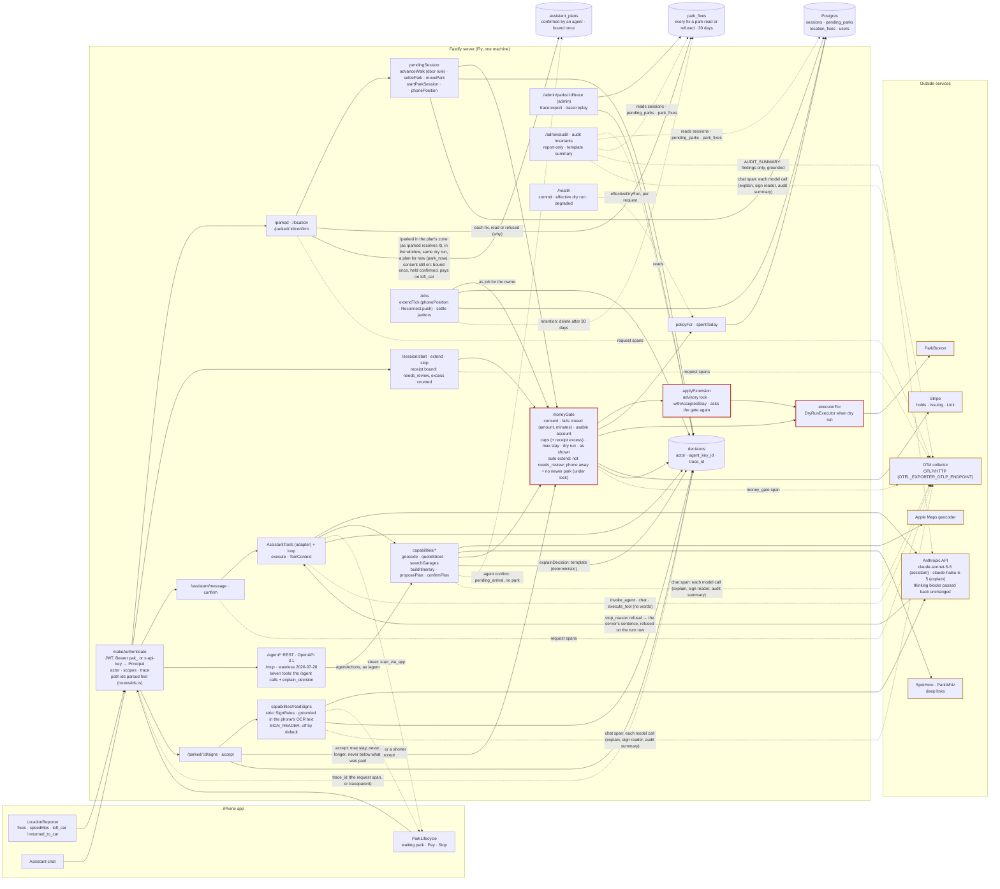
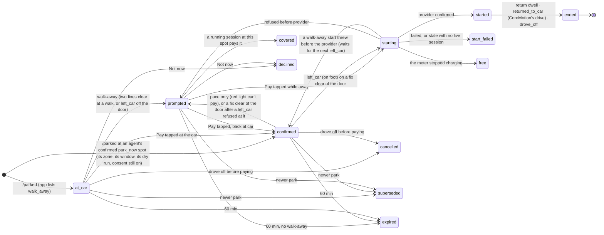
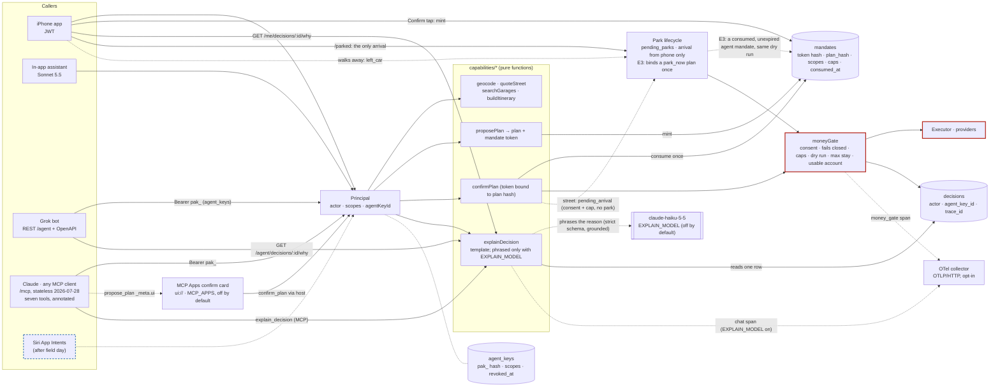
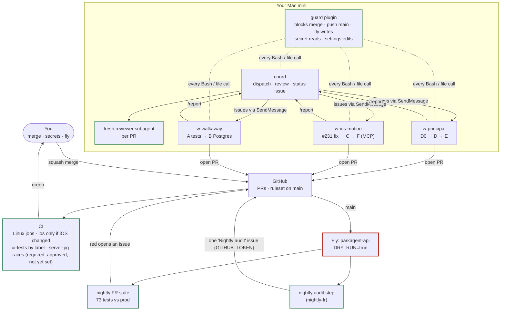

# ParkAgent architecture

Four views of how the system fits together. Mermaid renders on GitHub.
**Rule:** a PR that changes a flow shown here updates the diagram and the matching row in `docs/feature-map.md` in the same PR. Red = money can move; dashed blue = planned.

## Runtime today

The phone senses, the server decides, providers execute. Every request authenticates through one function, and money passes through one gate, `moneyGate`, whoever asks.

## Park lifecycle: when a session gets paid

Each park the phone reports becomes a `pending_parks` row. Every transition is a compare-and-set on the previous status, so two requests can't both start a session. `starting` is the only state where money is in flight.

A newer park supersedes a park still waiting, at any distance. More than 100 m from a running session's car, it marks the car moved (`car_moved_at`, `noteCarMoved`), and the extension worker buys that session nothing more. Every move that gives a park its session goes through one helper, `movePark`: a compare-and-set from the state it was read in, then the caller's ledger row, then the newer-park check (`noteNewerParkSince`), whether the start settled, a late success adopted it, a relink did, the stale-start sweep did, or the start threw. So a park that was mid-start or closed when the newer one landed is checked the moment it takes a session, and that session is never extended for a spot the car left (#246, #285). As a belt, the worker and the gate under the extension lock read the newest park again (`checkNewerPark`) before buying time. Accepted: `/parked` doesn't take the extension lock, so a newer park that lands while the provider is charging still buys that one extension, within the caps.

The door rule (#287): the app's `left_car` is not the walk-away when its fix may have the phone at the car's door (`mayBeAtTheDoor`: distance − accuracy ≤ 10 m, or accuracy over 65 m). The refused walk is kept (`walk_said_at`, `walk_said_usable`), and the next fix off the door, at a walk, reads as `fix_away`: it asks again and never pays by itself, so only a second tap pays. A usable fix within 30 m since, a pace over 3 m/s since, or `returned_to_car` forgets it.

Where the phone is for a running session is the lifecycle's alone (`phonePosition`, `services/pendingSession.ts`, #301): the park row the walk rules keep, plus the newest fix that is still reporting, judged on its report time (`ts`) within the last 5 minutes, so a still phone's heartbeat keeps it counting. A usable fix within 30 m of the car reads `at_car`, whatever the walk rules hold, and `/location` doesn't store a fix sent more than 5 minutes ahead of the server's clock. The extension worker reads it, and the money gate reads it again under the extension lock. Neither measures distance itself, and a session with no park row is `unknown`, so nothing is bought for it. The worker's cost model reads only a walk trend over the last 10 minutes of the same fixes (distance, heading, walk ETA), which prices an extension and never says the phone is away.

Open before `DRY_RUN=false`: a drive-off straight after a return never sets `back_at` (#306); the car-moved rule ignores fix accuracy and zone boundaries (#291); a tap from the seat after a real walk-away pays (#293); a retried tap can pay a park that was asked again (#307).

## WS-4 as built: one gate for every caller

The app, the in-app assistant, Grok over REST, and Claude over MCP are all callers of the same capability functions. Who is acting travels as a `Principal`; one money gate decides; the phone stays the only source of arrival. An agent's street confirm writes no park: it leaves a confirmed `park_now` plan and its consumed mandate, and the phone's next `/parked` at that zone, inside the mandate's 10 minutes and under the same dry run, with the person's consent still on, binds to it once (E3).

## How it gets built

A coordinator session plans and reviews; workers each own one branch in their own worktree; you merge. Guard, the branch ruleset, CI and the nightly suite stand between any session and production.

