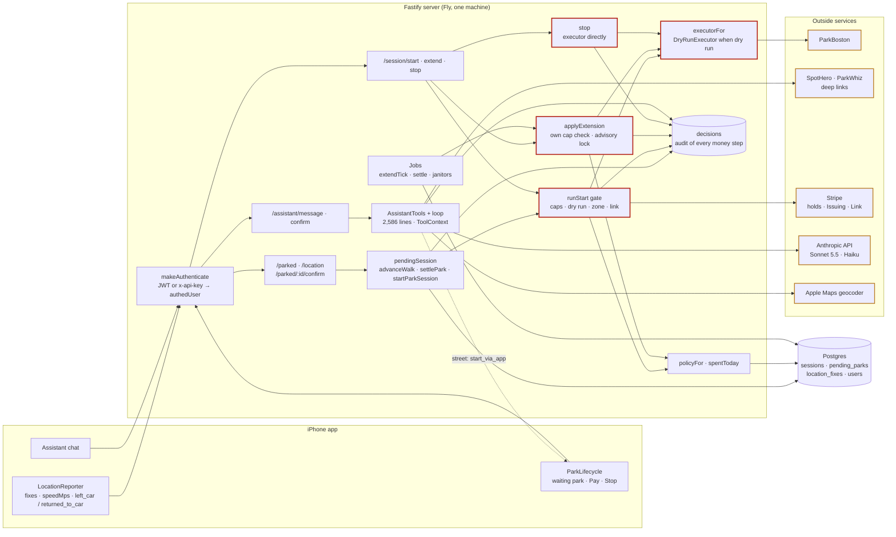
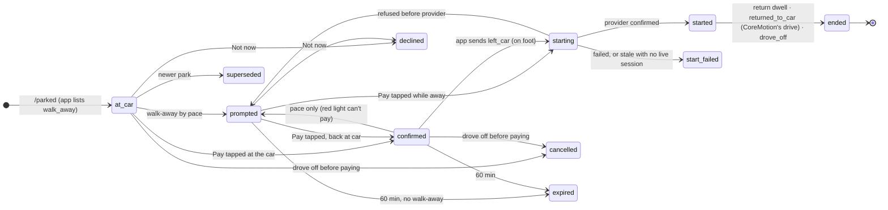
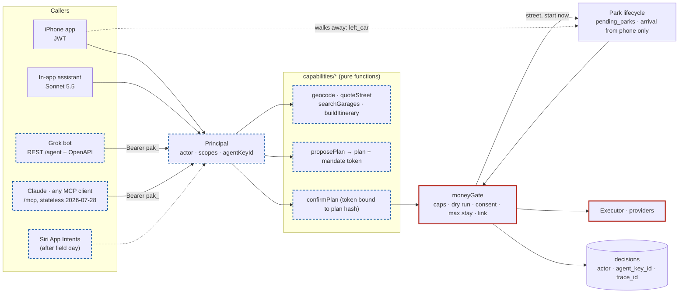
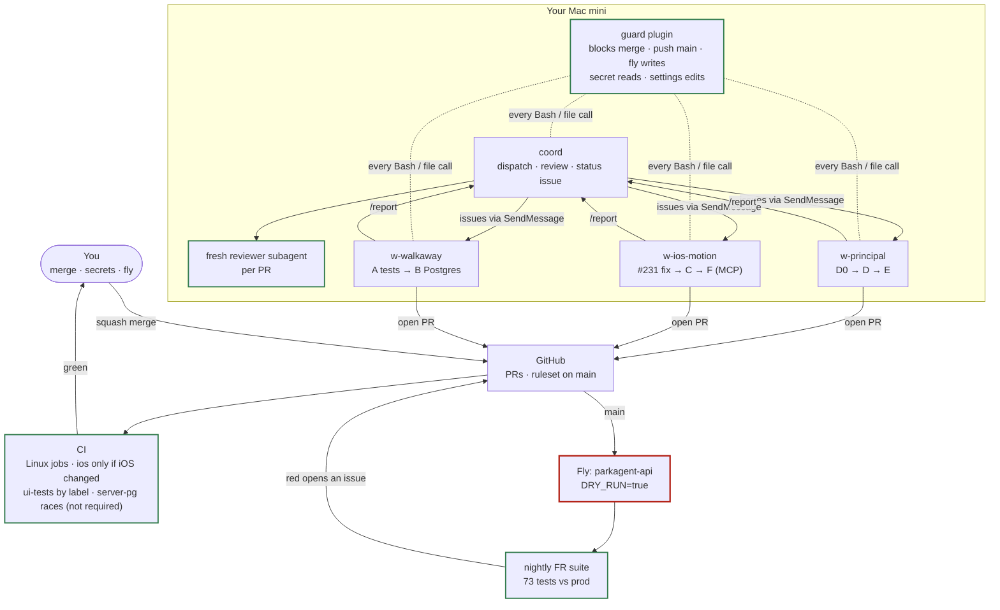

# ParkAgent architecture

Four views of how the system fits together. Mermaid renders on GitHub.
**Rule:** a PR that changes a flow shown here updates the diagram and the matching row in `docs/feature-map.md` in the same PR. Red = money can move; dashed blue = planned.

## Runtime today

The phone senses, the server decides, providers execute. Every request authenticates through one function, but money passes through three different gates depending on whether it's a start, an extension or a stop.

## Park lifecycle: when a session gets paid

Each park the phone reports becomes a `pending_parks` row. Every transition is a compare-and-set on the previous status, so two requests can't both start a session. `starting` is the only state where money is in flight.

## After WS-4: one gate for every caller

The app, the in-app assistant, Grok over REST, and Claude over MCP all become callers of the same capability functions. Who is acting travels as a `Principal`; one money gate decides; the phone stays the only source of arrival.

## How it gets built

A coordinator session plans and reviews; workers each own one branch in their own worktree; you merge. Guard, the branch ruleset, CI and the nightly suite stand between any session and production.

